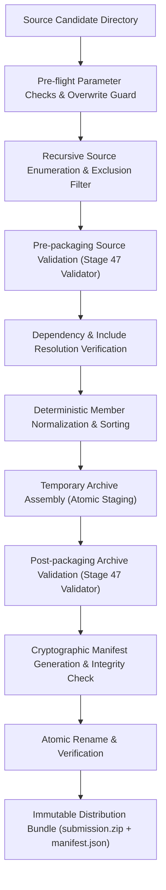

# IMPULSE Deterministic Submission Packaging Architecture (Stage 48)

---

## 1. Executive Summary

Stage 48 establishes the authoritative, bit-for-bit deterministic submission packaging subsystem for **IMPULSE** (`local/packaging/packager.py`, `scripts/package_submission.py`). It transforms candidate agent directories into reproducible, secure, and competition-compliant ZIP packages with accompanying cryptographic manifests (`submission.manifest.json`).

The packager enforces bitwise determinism across distinct execution environments, machines, timezones, and directory layouts, ensuring that identical repository states always produce identical SHA-256 archive digests.

---

## 2. Determinism Guarantees

Bitwise determinism is achieved through six strict invariants:

1. **Fixed UTC Timestamp:**
   All archive entries have their `date_time` set to `(2026, 1, 1, 0, 0, 0)` UTC.
2. **Canonical Lexicographical POSIX Sort:**
   Members are sorted by normalized relative POSIX paths (`sorted(entries, key=lambda m: m.posix_path)`). Member placement in the ZIP central directory and local headers is completely independent of filesystem traversal order.
3. **Normalized Unix Permissions & Attributes:**
   External file attributes are standardized to regular file mode `0o100644` (`0o644 << 16`), neutralizing variations between Windows NTFS ACLs and POSIX permissions.
4. **Deterministic Compression Parameters:**
   Standard Deflate compression (`zipfile.ZIP_DEFLATED`, level 6) is applied uniformly.
5. **Zero-Extended Headers:**
   Extra field extensions (such as Info-ZIP timestamp blocks `0x5455` and UNIX UID/GID `0x7875` that leak host metadata) are purged.
6. **Virtual In-Memory Staging & Atomic Persistence:**
   The archive is assembled in a temporary file adjacent to the destination (`*.tmp_<pid>_<uuid>.zip`). Post-packaging validation runs against the assembled archive before atomically renaming it to the final destination, preventing partial or corrupt archives from remaining on disk.

---

## 3. Packaging Pipeline Architecture



### Pipeline Steps:

1. **Pre-flight Safety Checks:**
   - Validates existence of source directory.
   - Evaluates overwrite protection for output ZIP and manifest (fails with exit code 3 unless `--force` is specified).
   - Computes baseline pre-packaging source directory hash.
2. **Safe Source Enumeration & Exclusion Filter:**
   - Traverses files recursively using `os.walk(followlinks=False)`.
   - Rejects symlink files and symlink directories immediately.
   - Rejects directory traversal (`..`) and absolute path escapes.
   - Filters prohibited development files (`.git`, `.gitignore`, `__pycache__`, `*.pyc`, `*.log`, `*.tmp`, unit tests `test_*.py`).
3. **Pre-packaging Source Validation:**
   - Invokes `PackageValidator` on source tree with `ignore_excluded_dev_files=True`.
   - Validates root `agent.yaml`, declared base model (`gemma-4-31b-it-qat-w4a16-ct`), predefined tool limits, instruction limits, and scans text files for credentials.
4. **Dependency Resolution Verification:**
   - Traverses all `!include` directives and subagent declarations recursively.
   - Ensures all referenced prompt files, subagent configs, and skill manifests exist within the collected package members.
5. **Deterministic Archive Assembly:**
   - Sorts collected members lexicographically.
   - Writes members into a temporary staging file (`submission.tmp_<pid>_<hash>.zip`) using standard fixed timestamps and file modes.
6. **Post-packaging Security Validation:**
   - Runs `PackageValidator` on the generated ZIP file using the authoritative Stage 47 validator.
   - Checks PKZIP headers, CRC-32 integrity, expansion bomb safety, secret hygiene, and YAML validity.
   - On validation failure, deletes temporary archive and halts with exit code 2.
7. **Manifest Generation & Atomic Finalization:**
   - Generates `submission.manifest.json` recording archive SHA-256, byte sizes, member hashes, Git status, and validator summary.
   - Atomically renames temporary archive to destination path.
   - Verifies post-packaging source directory hash equals pre-packaging hash (`SourceImmutabilityInvariant`).

---

## 4. Exclusion Rules Taxonomy

| Category | Excluded Patterns / Directories | Rationale |
| :--- | :--- | :--- |
| **VCS Metadata** | `.git`, `.gitignore`, `.gitattributes`, `.github` | Prevent repository history and configuration leakage. |
| **Python Bytecode** | `__pycache__`, `*.pyc`, `*.pyo`, `*.pyd` | Prevent non-deterministic platform bytecode inclusion. |
| **Virtual Environments** | `.venv`, `venv`, `env`, `.tox` | Exclude host environment binaries. |
| **Scratch & Tests** | `test_*.py`, `*_test.py`, `tests/` | Exclude test suites from submission root. |
| **Logs & Dumps** | `*.log`, `*.tmp`, `*.bak`, `*.swp` | Eliminate transient debug output. |
| **Secrets & Env** | `.env`, `.env.*` | Enforce zero-secrets policy. |

---

## 5. Manifest Specification (`submission.manifest.json`)

```json
{
  "manifest_version": "1.0.0",
  "packager_version": "1.0.0",
  "timestamp": "2026-10-23T14:00:00Z",
  "source": {
    "relative_path": "experiments/candidates/M0",
    "source_dir_name": "M0",
    "candidate_id": "M0"
  },
  "git_info": {
    "commit": "53c16beccb7920575e41ada1de8ee4b671c591cf",
    "dirty": false,
    "branch": "main"
  },
  "package_metadata": {
    "base_model": "gemma-4-31b-it-qat-w4a16-ct",
    "agent_name": "impulse_m0_root_only",
    "root_config": "agent.yaml"
  },
  "archive": {
    "filename": "submission.zip",
    "sha256": "...",
    "byte_size": 13731,
    "deterministic_settings": {
      "fixed_timestamp": "2026-01-01T00:00:00+00:00",
      "compression": "deflated",
      "compresslevel": 6,
      "file_mode": "0644",
      "sort_order": "lexicographical_posix"
    }
  },
  "members": [
    {
      "path": "agent.yaml",
      "size_bytes": 640,
      "sha256": "..."
    }
  ],
  "aggregates": {
    "total_files": 5,
    "total_uncompressed_bytes": 31828
  },
  "validator_summary": {
    "overall_valid": true,
    "checks_executed": 17,
    "passed": 15,
    "failed": 0,
    "warnings": 0,
    "skipped": 1,
    "unavailable": 1
  },
  "excluded_files": [],
  "build_outcome": "SUCCESS",
  "notes": "Declarative YAML package verified. Official compiler check unavailable locally."
}
```

---

## 6. CLI Usage & Exit Codes

### Command Syntax:
```bash
python scripts/package_submission.py --source <dir> [options]
```

### Options:
- `--source PATH`: Path to candidate directory (required).
- `--output PATH`: Destination `.zip` archive (defaults to `<source>/submission.zip`).
- `--manifest PATH`: Destination `.manifest.json` (defaults to `<source>/submission.manifest.json`).
- `--check-only`: Dry-run mode; validates and prints plan without writing files.
- `--strict`: Treats warnings as validation errors.
- `--force`: Overwrites existing output archive and manifest.
- `--json`: Outputs machine-readable JSON summary.

### Exit Codes:
- `0`: Success (package built and verified).
- `1`: Source validation or dependency resolution failure.
- `2`: Post-packaging validation failure.
- `3`: User input, CLI, or filesystem error (missing source, existing target without `--force`).
