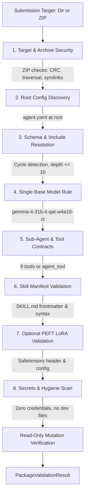

# IMPULSE — Submission Package Validation Architecture (Stage 47)

**Document:** `docs/experiments/package_validation.md`  
**Status:** Canonical Reference Architecture  
**Stage:** 47 (Package Validator)  
**Schema Version:** `v1.0.0` / Ruleset `2026.1`  
**Authority:** [HARNESS_README.md](file:///e:/Projects/Impulse/data/competition/HARNESS_README.md) Section 2 & 3, Kaggle Gemma 4 Competition Overview  

---

## 1. Executive Summary & Purpose

In the **Google Gemma 4 Developer Agent Competition**, participants submit an agent archive (`submission.zip`) rather than unstructured code or arbitrary execution scripts. In the Kaggle scoring container, the host runner compiles the package into a sandboxed Google ADK agent hierarchy (`adk-submission compile <submission_dir>`) and serves `gemma-4-31b-it-qat-w4a16-ct` on 4x NVIDIA L4 GPUs via vLLM.

Stage 47 implements the **IMPULSE Package Validator**, a trustworthy, standalone validation subsystem that verifies both:
1. **Candidate Directories** (e.g., `experiments/candidates/M0` through `M5`); and
2. **Physical ZIP Archives** (e.g., `submission.zip`), including raw central directory structures, member paths, and binary headers.

The validator rejects invalid packages with deterministic, actionable diagnostics while accepting valid packages without requiring GPU hardware or live 31B model inference.

> [!IMPORTANT]
> **Structural Validity vs. Task Performance**:
> A structurally valid package proves compliance with competition schema, security sandboxing, path containment, and resource limits. It is **not** proof that the live agent solves benchmark tasks successfully. Package validity remains strictly decoupled from benchmark scores and leaderboard rankings.

---

## 2. Core Architectural Distinction: Compiler vs. Validator

| Dimension | Official Competition Compiler | Local Package Validator (`local.packaging`) |
| :--- | :--- | :--- |
| **Command** | `adk-submission compile <submission_dir>` | `python scripts/validate_submission.py <path>` |
| **Execution Environment** | Dedicated Kaggle evaluation container (`swebench-sandbox`) | Local development host (Windows 11 / Linux) |
| **Implementation** | Closed-source competition harness library | Declarative Python 3.13 verification tool |
| **Dependencies** | Linux process groups (`os.killpg`), Docker, vLLM | Pure Python standard library + PyYAML (zero network, zero Docker) |
| **Status on Workstation** | **UNAVAILABLE** (Preserved as `CheckStatus.UNAVAILABLE`) | **VERIFIED & OPERATIONAL** (All 51 focused tests passing) |
| **Reporting Invariant** | Never claimed as executed when missing | Explicitly reports unavailable compiler without failing structural checks |

---

## 3. Supported Validation Targets

The validator exposes a unified interface via [`local.packaging.PackageValidator`](file:///e:/Projects/Impulse/local/packaging/validator.py) and [`scripts/validate_submission.py`](file:///e:/Projects/Impulse/scripts/validate_submission.py):

### A. Candidate Directory Target
```bash
python scripts/validate_submission.py experiments/candidates/M0
```
- Traverses candidate files directly via [`DirectoryPackageReader`](file:///e:/Projects/Impulse/local/packaging/reader.py).
- Enforces root config discovery, path containment, extension allowlists, size limits, and secret scanning.
- Verifies directory immutability (directory file manifest hash before == hash after).

### B. ZIP Archive Target
```bash
python scripts/validate_submission.py path/to/submission.zip
```
- Virtual in-memory inspection via [`ArchivePackageReader`](file:///e:/Projects/Impulse/local/packaging/reader.py) without extracting untrusted files into the repository.
- Evaluates central directory integrity, CRC-32 checksums, path traversal attacks, symlinks, and archive bombs.
- Verifies archive immutability (SHA-256 before == SHA-256 after).

---

## 4. Eight-Phase Validation Pipeline



### Phase 1: Archive Integrity & Path Security (`ARCHIVE_SECURITY`)
- **PKZIP Verification**: Validates ZIP file format headers and runs `zf.testzip()` for CRC-32 integrity.
- **Path Attack Defense**:
  - Rejects `..` traversal components (`ARCH_NO_TRAVERSAL`).
  - Rejects absolute paths starting with `/` or `\` (`ARCH_NO_ABSOLUTE_PATH`).
  - Rejects Windows drive letters e.g. `C:/` (`ARCH_NO_DRIVE_PATH`).
  - Rejects UNC network shares e.g. `//server/share` (`ARCH_NO_UNC_PATH`).
  - Rejects null bytes in member names (`ARCH_NO_NULL_BYTES`).
- **Symlink Protection**: Inspects member `external_attr` upper 16 bits; rejects Unix `S_IFLNK` (`0o120000`) entries (`ARCH_NO_SYMLINKS`).
- **Collision Protection**: Detects duplicate member names (`ARCH_NO_DUPLICATE_MEMBERS`), case-insensitive collisions (`ARCH_NO_CASE_COLLISION`), and file/directory name collisions (`ARCH_NO_FILE_DIR_COLLISION`).
- **Encryption Check**: Detects encrypted members via `flag_bits & 0x1` (`ARCH_NO_ENCRYPTION`).
- **Zip-Bomb Guard**: Flags members $> 1$ MiB with compression expansion ratios $> 100:1$ (`ARCH_SUSPICIOUS_COMPRESSION`).
- **Resource Limits**: Total uncompressed size $\le 3,221,225,472$ bytes ($< 3$ GiB), member count $\le 10,000$, YAML file count $\le 1,000$, single YAML size $\le 50$ MiB.

### Phase 2: Root Config Discovery (`SCHEMA_CONFIG`)
- Exactly one root configuration file (`agent.yaml`, `agent.yml`, `root_agent.yaml`, or `root_agent.yml`) must reside directly at the archive root.
- Rejects missing entrypoint (`MissingRootConfigError`), multiple entrypoints (`MultipleRootConfigsError`), or configs nested inside subdirectories (e.g. `submission/agent.yaml`).

### Phase 3: Configuration & Include Resolution (`SCHEMA_CONFIG`)
- Parses YAML mappings recursively.
- Resolves `!include` directives relative to containing file's directory:
  - Allowed extensions: `.md`, `.txt` (raw text embedding), `.yaml`, `.yml` (recursive dictionary inclusion).
  - Traversal defense: Target must resolve strictly within package root.
  - Cycle detection: Tracks include call stack; raises `IncludeCycleError` on recursive inclusion.
  - Depth bounds: Enforces maximum inclusion depth of $\le 10$.
  - Generational parameters: Verifies `max_output_tokens \le 32,768`, `thinking_budget \le 32,768`, and valid `thinking_level`.
  - Prohibited fields: Flags fields that alter the sandbox environment (`tools`, `system_instruction`, `http_options`, `safety_settings`, `response_schema` inside `generate_content_config`).

### Phase 4: Model & Sub-Agent Consistency (`MODEL_TOOL`)
- **Single Base Model Rule**: All declared models across the root agent, all `sub_agents`, and all `agent_tool` references must share the identical normalized base model (`gemma-4-31b-it-qat-w4a16-ct`).
- Provider prefixes (`google/`, `openai/`, `hosted_vllm/`, `custom/`) are normalized.
- Tool contracts: Predefined tools must belong to the closed 9-tool registry (`run_command`, `submit_patch`, `get_status`, `read_file`, `edit_file`, `write_file`, `get_code_neighbors`, `search_similar_code`, `get_code_subgraph`).

### Phase 5: Skill Validation (`SKILL_MANIFEST`)
- Referenced skill directories must exist inside the package.
- `SKILL.md` manifest must exist and contain valid YAML frontmatter (`---`).
- Required frontmatter field `name: str` must be present and non-empty.
- Skill directory size must not exceed $50$ MiB.
- Static Python syntax check: Any `.py` scripts inside a skill directory are parsed using Python's `ast.parse()` to guarantee syntax correctness without executing the scripts.

### Phase 6: Optional PEFT LoRA Adapter Validation (`ADAPTER_PEFT`)
- LoRA is optional; packages without adapters remain fully valid (`CheckStatus.SKIPPED`).
- If `adapter: <name>` is declared:
  - Directory `adapters/<name>/` must exist locally in the package.
  - `adapter_config.json` must exist, parse as valid JSON, declare `peft_type: "LORA"`, have rank $r \in [1, 128]$, and declare `target_modules`.
  - `adapter_model.safetensors` must exist; the first 8 bytes (little-endian uint64 length prefix) and subsequent JSON tensor header are verified without loading full weights.
  - Pickle-based weights (`.bin`, `.pt`, `.pth`, `.pkl`) are strictly rejected.

### Phase 7: Secret Scanning & Development Hygiene (`SECRET_HYGIENE`)
- Scans all text-based files for credentials using regex patterns (GitHub tokens `ghp_`, AWS keys `AKIA`, Hugging Face tokens `hf_`, Kaggle keys `kaggle_`, private keys `-----BEGIN ... PRIVATE KEY-----`, hardcoded API keys/passwords).
- **Masked Diagnostics**: Secret values are strictly redacted in diagnostic output (e.g. `ghp_***REDACTED***`).
- Rejects `.env` files (`.env`, `.env.local`, etc.).
- Rejects development directories (`.git`, `__pycache__`, `.pytest_cache`, `.coverage`, `node_modules`, `.idea`, `.vscode`).
- Rejects development files (`tasks.jsonl`, `held_out.lock`, `PLAN.md`, `IMPULSE.md`, `AGENTS.md`).
- Rejects unit tests packaged at package root (`test_*.py`).
- Emits warnings on machine-specific absolute developer paths (`C:\Users\...` or `/home/...`).

### Phase 8: Read-Only Mutation Safety Invariant (`MUTATION_SAFETY`)
- Target SHA-256 (for ZIP) or directory manifest hash (for directory) is recorded before validation begins.
- Target is re-hashed upon validation completion; validator guarantees $100\%$ byte-for-byte immutability (`initial_hash == final_hash`).

---

## 5. Result Model & Check Taxonomy

Every check produces a structured [`CheckResult`](file:///e:/Projects/Impulse/local/packaging/models.py):

```python
@dataclass(frozen=True)
class CheckResult:
    check_id: str
    category: CheckCategory
    status: CheckStatus       # PASS | FAIL | WARNING | SKIPPED | UNAVAILABLE
    severity: CheckSeverity   # FATAL | WARNING | INFO
    target: str
    expected: str
    observed: str
    diagnostic: str
    rule_ref: str
```

### Check Categories & Stable IDs:
- **`ARCHIVE_SECURITY`**: `ARCH_EXISTS`, `ARCH_VALID_ZIP`, `ARCH_OPEN`, `ARCH_INTEGRITY`, `ARCH_MEMBER_COUNT`, `ARCH_TOTAL_SIZE`, `ARCH_NO_DUPLICATE_MEMBERS`, `ARCH_NO_NULL_BYTES`, `ARCH_NO_SYMLINKS`, `ARCH_NO_ENCRYPTION`, `ARCH_NO_ABSOLUTE_PATH`, `ARCH_NO_DRIVE_PATH`, `ARCH_NO_UNC_PATH`, `ARCH_NO_TRAVERSAL`, `ARCH_SUSPICIOUS_COMPRESSION`, `ARCH_NO_CASE_COLLISION`, `ARCH_NO_FILE_DIR_COLLISION`, `ARCH_ALLOWED_EXTENSIONS`, `ARCH_NO_PROHIBITED_WEIGHTS`, `ARCH_MAX_YAML_SIZE`, `ARCH_ROOT_CONFIG`.
- **`SCHEMA_CONFIG`**: `CONFIG_ROOT_DISCOVERY`, `CONFIG_EXISTS`, `CONFIG_READ`, `CONFIG_YAML_SYNTAX`, `CONFIG_SCHEMA_MAPPING`, `CONFIG_AGENT_NAME`, `CONFIG_INSTRUCTION_LENGTH`, `CONFIG_PROHIBITED_FIELD`, `CONFIG_MAX_OUTPUT_TOKENS`, `CONFIG_THINKING_BUDGET`, `CONFIG_THINKING_LEVEL`, `INCLUDE_MAX_DEPTH`, `INCLUDE_PATH_TRAVERSAL`, `INCLUDE_CYCLE`, `INCLUDE_NOT_FOUND`, `INCLUDE_INVALID_EXTENSION`.
- **`MODEL_TOOL`**: `MODEL_DECLARED`, `MODEL_SINGLE_BASE`, `MODEL_PERMITTED_ALIAS`, `TOOL_PREDEFINED`.
- **`SKILL_MANIFEST`**: `SKILLS_REFERENCED`, `SKILL_DIR_EXISTS`, `SKILL_MAX_SIZE`, `SKILL_MD_EXISTS`, `SKILL_FRONTMATTER_EXISTS`, `SKILL_FRONTMATTER_PARSE`, `SKILL_FRONTMATTER_SCHEMA`, `SKILL_MANIFEST_NAME`, `SKILL_SCRIPT_SYNTAX`.
- **`ADAPTER_PEFT`**: `ADAPTER_REFERENCED`, `ADAPTER_PATH_TRAVERSAL`, `ADAPTER_DIR_EXISTS`, `ADAPTER_PROHIBITED_WEIGHTS`, `ADAPTER_CONFIG_EXISTS`, `ADAPTER_PEFT_TYPE`, `ADAPTER_RANK_BOUNDS`, `ADAPTER_TARGET_MODULES`, `ADAPTER_WEIGHTS_EXISTS`, `ADAPTER_SAFETENSORS_HEADER`.
- **`SECRET_HYGIENE`**: `SECRET_DETECTED`, `SECRET_SCAN_CLEAN`, `HYGIENE_NO_ENV_FILES`, `HYGIENE_NO_DEV_DIRS`, `HYGIENE_NO_DEV_FILES`, `HYGIENE_NO_TEMP_FILES`, `HYGIENE_NO_TEST_FILES`, `HYGIENE_HOST_PATH`.
- **`COMPILER_OFFICIAL`**: `COMPILER_OFFICIAL_AVAILABILITY`.
- **`MUTATION_SAFETY`**: `MUTATION_SAFETY_INVARIANT`.

---

## 6. CLI Usage & Reporting Options

### Standard Directory Inspection:
```bash
python scripts/validate_submission.py experiments/candidates/M0
```

### Submission ZIP Archive Inspection:
```bash
python scripts/validate_submission.py path/to/submission.zip
```

### Machine-Readable JSON Output:
```bash
python scripts/validate_submission.py path/to/submission.zip --json
```

### Strict Warning Mode (warnings trigger exit code 1):
```bash
python scripts/validate_submission.py path/to/submission.zip --strict
```

### Exit Codes:
- `0`: Validation PASSED (all fatal checks satisfied; warnings tolerated unless `--strict`).
- `1`: Validation FAILED (fatal security/schema error, corrupt ZIP, missing entrypoint, secret detected, or strict warnings present).

---

## 7. Developer & Extension Guidelines

1. **Adding a New Validation Rule**:
   - Define a stable check ID in the appropriate module (`archive_security.py`, `config_validator.py`, etc.).
   - Assign appropriate `CheckCategory`, `CheckSeverity`, and `rule_ref`.
   - Never print raw unredacted file content in `diagnostic` if checking sensitive files.
2. **Never Execute Untrusted Package Code**:
   - Python files within skills must be checked exclusively using AST compilation (`ast.parse()`), never imported with `importlib` or run via `subprocess`.
3. **Keep Packaging Read-Only**:
   - The validator must never write, alter, or touch the candidate directory or ZIP archive during execution.
